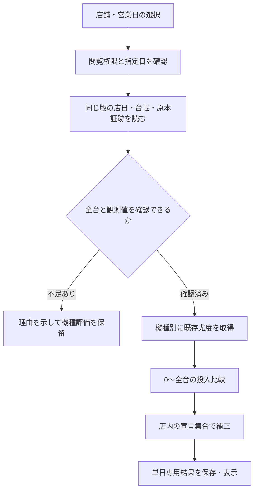

# JUGEST 店舗単日・高設定投入分析エンジン 詳細設計

作成日：2026年10月17日（日本時間）  
状態：実装判断用の設計案。新エンジンは未実装・未校正。既存コード・開発ブランチ・本番システムの変更なし。  
調査基準：[deploy/vps @ 1f8c29fc458f34e11e546fb57944d0fc31db98a5](https://github.com/2qt9wrwbj9-web/jugest/tree/1f8c29fc458f34e11e546fb57944d0fc31db98a5)

## 0. 実装判断のための要点

**推奨は、既存JUGESTの「各設定でデータがどれだけ起こりやすいか」を再利用し、高設定が0台から全台までの全ケースを比較する新しい単日分析層を追加すること。** 好調な台を数えて投入台数に置き換える方式は採用しない。

例えば12台なら、0、1、…、12台の投入を、台の選び方の全組合せを平均して比較する。「6台投入が一番合う」という推定と、「4台以下の投入でも十分説明できる」という不確実性を同時に表示する。全台系・半分以上・1/3以上は、この台数分布から取り出す。

通常配分をひとつ仮定して比較するだけでは、都合の悪い配分を見逃す。そこで、①仮定を明示した投入台数推定、②低設定中心・中間中心などとの比較、③投入が少ない側に最も有利な設定配置との慎重な比較、を分ける。③は見逃しが増える代わりに、上振れを候補にしてしまう危険を抑える。

現時点では、店舗の本当の投入頻度も、実店舗での新機能の的中率も分からない。**「全456の確率80%」を前提なしに主表示する案は推奨しない。** 百分率を出す場合は「指定した配分の仮定の下での推定」とし、仮定・計算方法・感度を一緒に示す。

実装可否の判断は次の2段階に分ける。

1. **参考分析としての実装**：全台数比較、根拠比、判断保留、取得漏れの表示を完成させる。
2. **強い候補表示の有効化**：誤検出対策の数学・シミュレーション・実用上の検出力を確認する。前提外のデータに、検証済みの誤検出率を当てはめない。

単日データだけで上振れを完全に排除することはできない。設定3と4のように確率が近い設定や、低稼働台については、正しく保留すること自体が必要な機能となる。

## 1. 調査の範囲と確かめた事実

### 1.1 GitHub・完成版・本番の照合

| 対象 | 今回確認した状態 | 解釈 |
|---|---|---|
| 過去の完成版 | `eb8a9e175cbcaeacea41481a8ffe053456b94e31` | 並列判別・全台系エンジンと検証記録が存在 |
| 現在のGitHub本番用ブランチ | `deploy/vps @ 1f8c29fc458f34e11e546fb57944d0fc31db98a5` | 今回の調査基準 |
| 実サーバーのcurrentとGit HEAD | 同じ `1f8c29f…` | 過去の完成報告だけから本番状態を推測していない |
| GitHub上の完成版からの差分 | 1コミット、2ファイル | `group-judge-view.js` と `tests/parallel-group-ui.mjs`。説明・表示の簡潔化 |
| 実サーバーの追跡ファイル | 調査時点で変更なし | `git status --porcelain --untracked-files=no` |
| 公開health | HTTP 200、`ok:true` | 稼働確認。数学の正しさの証明には使わない |
| GitHubのmain | `273ed61ed2019365ae1b38d76288f20e9625c9e1` | 本番と同一と仮定しない |

以下のファイルは、GitHubから取得した調査用コピーと実サーバー上のソースのSHA-256が一致した。さらに公開配信中の全台系エンジン・表示部・判別モデル3ファイルについて、配信された内容の一致も確認した。

| ファイル | SHA-256 |
|---|---|
| `group-judge.js` | `fc5c6495235f9ae206944c09e9510a35826cf354af72e910d32ba7d3dda9aabc` |
| `group-judge-view.js` | `57c37c470aff0c99430511a07c9609db14ed05815ec39b9014a510444742977d` |
| `judgement-model.js` | `4a6af35a9ecc987f80d684f7cae9f9d12453dad28fc585bac927ff558ffc3e21` |
| `index.html` | `45380050bab5a00543247cb3639c35dc50f8fad903a879980298538f749e9a77` |
| `app-v510.js` | `5106ef332bd7f226956ee609e93b3675e4fcbd174b2c9b96e81cbf608dc3b406` |
| `vps/src/judge/juggler-external-judge.mjs` | `e78138f2f2c481de0f2beff1dd627d05ce05e5149a9b9cdee06d02ddce65b750` |
| `vps/src/analysis/store-data.mjs` | `99769563fea457a31e03ffbf77cfe4dadb6f2c3e5cce779d69926c029eb4c795` |
| `vps/src/ingest/canonical-ingest.mjs` | `f9045da5447539720ae406e38ff6ca5a5ccb50e24c13c68765191db7dd16a753` |
| `vps/src/ui-source-patch.mjs` | `797133e143315703c12f913942eb5519d48868f84bd3029edabc4f35c9d99ff7` |

サーバーはソースを配信時に加工する。`ui-source-patch.mjs` が店舗データ参照などを変更していることを確認した。元HTMLだけを読んだ設計にはしない。今回、全画面を本番ブラウザーで再操作したわけではなく、最新UIの確認範囲は配信内容・ソース・既存テストに限る。

### 1.2 読んだ主要資料と実装

| 役割 | 一次資料・コード | 確認事項 |
|---|---|---|
| 開発・本番ルール | `AGENTS.md` | 数学の無断変更禁止、本番反映は直前許可、配信時加工の存在 |
| 既存設計 | `docs/superpowers/specs/2026-10-10-parallel-group-judge-design.md` | 尤度・根拠比・条件付き配分・反証の意味 |
| 完成時の数学検証 | `docs/development/completion-20261012/math-validation.md` | 全列挙、独立数値照合、4,800反復の範囲と限界 |
| 本番反映の記録 | `production-deployment-report-20261014.md`（過去の開発側保存資料） | eb8a9e1反映の過去記録。現在状態は別途確認 |
| 各台判別 | `index.html` の `externalBonusJudgeQ`、`reverseCoreKnown`、`reverseCore`、`v510JudgeObservedMachine` | 現在の設定別ログ値と通常設定確率 |
| 全台系 | `group-judge.js`、`group-judge-view.js` | 補集合との比較、条件付き配分、2〜60台制限 |
| 既存の島の見立て | `index.html` の `jdataFitAllocationFamily`、`jdataCompareAllocationModels` | 別の候補配分比較であり、投入台数エンジンではない |
| サーバー判別 | `analysis/runtime-adapter.mjs`、`judge/juggler-external-judge.mjs` | 個別qは残すがログ尤度を返さない境界 |
| 保存と取得 | `schema.mjs`、`ingest/canonical-ingest.mjs`、`ingest/raw-archive.mjs`、`relay-handler.mjs` | 店日・台行・原本・内容ハッシュ・更新処理 |
| PIA取得 | `collectors/pia-public.mjs`、`collectors/pia-scheduler.mjs` | 履歴差分から営業日を特定、通常Gを元データから換算 |
| 認可とAPI | `analytics-handler.mjs`、`mcp-handler.mjs`、`store-access.mjs`、`access/handler.mjs` | 店舗データの閲覧権限と個別判別の分離 |
| 名称 | `machine-names.js` | 表記揺れの解決、マイⅤとⅥの識別 |

保存済みの収集基盤再設計資料 `JUGEST_collector_ロック後継続_再設計_20261010.md` も現物を読んだ。ただし「設計案・未実装」と明記されており、そこで提案された完全性保証を、現在の本番に実装済みとは扱わない。

### 1.3 本番の保存データで確認できたこと

本番DBは読み取り専用で開き、書き込みを禁止した接続で照会した。収集の開始、再解析ジョブの起動、データの更新は行っていない。

| 店舗・営業日 | 保存台数 | 機種別 | 品質確認 |
|---|---:|---|---|
| PIA大船1・2026-10-16 | 106 | マイⅥ58、ゴー24、ネオアイム24 | 0Gが1台、重複台番0、推定G0、保存上の差枚欠損0、原本参照あり |
| PIA大船1・2026-10-15 | 106 | 同上 | 同じく0Gが1台。全台取得を独立に証明したわけではない |
| ジアス大船・2026-09-27 | 108 | ジャグラーとハナハナが混在 | 台の分類が必要。店舗データ＝すべて今回の対応機種、とは限らない |

これは保存形・境界条件の調査であり、各台や店舗の設定判別結果ではない。真の設定は不明。最新の設置台数や機種構成を、過去の記憶の台数で上書きしない。

## 2. 既存の数学をどこまで再利用できるか

### 2.1 個別判別のログ値と設定確率

台iの通常Gを \(G_i\)、BBを \(B_i\)、RBを \(R_i\)、設定sのBB・RB発生確率を \(p_{B,s},p_{R,s}\) とする。ボーナスだけの既存ログ値は次の式。

\[
\ell_{i,s}=B_i\log p_{B,s}+R_i\log p_{R,s}
 +(G_i-B_i-R_i)\log(1-p_{B,s}-p_{R,s}).
\]

同じ台の観測に共通する多項係数は省略されている。設定や設定配置の比を取る際には相殺される。台別に任意の同じ定数を引いて、数値を安定化してよい。

通常の個別設定確率は、設定1〜6を同じ重みとして、\(\exp\ell_{i,s}\) を合計1へ正規化している。店舗の設定頻度を推定した確率ではない。

差枚ありでは、BB/RBの尤度に、ブドウ逆算からの正規近似スコアを加えている。打ち方不明の重みは通常 `.5/.5`、ハッピーとミスターは `.45/.45/.10`。これらは打ち方の混合重みであり、店舗の設定事前分布ではない。役の共分散・重複や、実際の掲載誤差を完全に表す生成分布にはなっていない。

**新しい投入台数の計算は、通常qを足し合わせて台数と断定せず、既存計算の同一呼出しから取得した設定別ログ値を使う。** qだけの保存結果を正として再利用する経路は作らない。現在のqなら等重み事前のため相対尤度に比例するが、丸め・将来の事前変更・ゼロ化に弱く、契約として不適切だからである。

### 2.2 現行の全台系エンジン

既存エンジンは全456、全56、全6を、それぞれ「少なくとも1台が許容設定の外」と比較する。基準重みを各仮説と補集合で条件付けし、補集合は2状態の動的計画法で直接積算している。大きな積からほぼ同じ積を引く計算は避けている。

提供されるのは、根拠比、ボーナスだけの根拠比、重み感度、整合しにくい台、ボーナス下振れの反証、仮説を条件とした配分である。全台系が成立する店舗頻度を仮定していないため、成立確率は返さない。この意味を変更しない。

条件付き配分の「設定4が何台、5が何台、6が何台」という表示は、**全456だと仮定した場合の内訳**。全456自体の成立根拠ではない。通常の各台qを書き換えない。

既存反証検査は、BB/RB/合計の下側二項確率を使い、観測種類・台数・3仮説の比較を補正している。反証なしは成立の証明ではない。今回の全機種探索の正の候補を選ぶ仕組みとは別である。

### 2.3 店舗画面の「島の見立て」は別機能

現行店舗画面には、単独設定、隣接設定帯、135/246、15/16などの候補を、群内配分の格子上で比較する別モデルがある。通常qを利用し、候補の複雑さに対する補正を加えて、候補集合内の重みや表示設定帯を決める。

等重み事前のqは相対尤度に比例するため、「qを使っているだけで無効」とは評価しない。ただし、候補集合、格子、微小値への置換、表示設定帯の選び方があり、**0〜n台の投入分布でも、通常配分に対して校正済みの全台系成立確率でもない**。ここの「設定帯支持」を新機能の投入確率に流用しない。

既存表示は維持し、新しい結果は「単日投入分析」と明示して併設する。既存表示の撤去や意味変更は別の提案・承認事項とする。

### 2.4 再利用と追加の境界

| 機能・資産 | 方針 |
|---|---|
| 確率表・個別判別・逆算式 | そのまま再利用。値・意味・打ち方重みを変更しない |
| `judgeObservedMachine`のログ捕捉 | 新しい内部アダプターから再利用 |
| 個別q・期待設定・P4+・MCP既存応答 | 変更しない |
| 全台系の既存比較 | そのまま残す。新エンジンとの一致検証に使う |
| 0〜n台の比較 | 新しい純粋計算モジュールで追加 |
| 全機種の同時探索・補正 | 新しく追加 |
| 完全性・ゼロ稼働・重複検査 | 新分析用の入力検証を追加。既存の受信処理を無断変更しない |
| 過去傾向・PRE・翌日予測 | 今回の単日計算から参照しない |

## 3. 要求仕様

### 3.1 利用範囲

- 入力は「店舗ID」と「営業日」。保存済みの当該店日を読み、機種ごとに自動分類する。
- 初期対応は現行個別判別と同じ9種類のジャグラー。店内の他機種も一覧に残し「未対応」と示す。
- 初期の意味は「機種ごとの投入状況」。店内で好調な台を集めた任意集合の探索ではない。
- 同一機種の複数島は原則として機種全体を1単位にする。島・列・並び探索は、結果を見る前に集合と比較数を定義した別機能とする。
- 営業終了前のデータは「途中経過」とし、終日分析と混ぜない。

### 3.2 必須出力

| 項目 | 定義 |
|---|---|
| 設置台数 | 当該営業日の分析対象機種の母集団。取得行数とは別 |
| 投入台数 | 設定4以上・5以上・6のそれぞれについて0〜n台を評価 |
| 推定の幅 | 指定した仮定下の台数分布、中央値、90%区間、仮定を変えた範囲 |
| 全台系 | 全456、全56、全6。包含関係を保つ |
| 半分・1/3 | 「ちょうど」と「以上」を別のイベントとして扱う |
| 通常配分比較 | 低設定中心・中間中心・一部高設定の宣言済みシナリオとの比較 |
| 偶然の候補対策 | 全機種・主要仮説の同時探索を考慮した慎重な評価 |
| 各台詳細 | 通常q、観測値、仮説の下での設定配分、矛盾・不足の説明 |
| 保留理由 | 取得漏れ、前提依存、低稼働、機種識別不能、計算・校正対象外など |

「推定6台」は、設定が確定した6台を意味しない。「期待台数6.0台」と「最も合う台数6台」も区別する。分布が広ければ単一の整数を主結論にしない。

### 3.3 禁止する近道

- P4+が50%以上の台数を投入台数とする。
- P4+の合計を、高設定がその台数存在する確率や確定台数として扱う。
- 好成績上位k台を選んでから、k台投入の根拠を計算する。
- 合算BB/RBを1台と見なした結果を、各台の証拠に重ねて使う。
- 差枚・推定G・推定差枚を独立した追加観測として重複計上する。
- 全456・全56・全6を排他的な3択にして合計100%にする。
- 当日の好成績を見て事前配分や通常配分を都合よく選ぶ。
- 不足台・0G台を消して設置台数を減らす。

## 4. 入力データの信頼性と対象集合

### 4.1 母集団を観測結果の前に決める

分析対象は当該日・当該機種に設置されていた全台。台集合の確定根拠を記録する。全台データが取得できたか不明な場合、「取得できた12台」を「設置12台」と読み替えない。

確定根拠は、当日原本の全台一覧・ページ送り完了・元データの件数・当日機種IDと台IDの一致を優先する。過去の台配置は欠損を検知する補助資料に使えても、その日の設定事前分布には使わない。機種変更・台移動が未確認なら完全取得と認定しない。

| 入力状態 | 新分析での扱い |
|---|---|
| 実測G>0、BB/RBが実測非負整数 | 全計算の対象 |
| 原本で0G、BB=RB=0が確認できる | 設置台数に残し、設定を区別する尤度を全設定1とする |
| G・BB・RBが不明 | 0に補わない。母集団に残し、正式な機種評価は保留 |
| 保存上のGが推定値 | 正式な投入推定には使わない。既存画面の参考値と分離 |
| 差枚のみ不明・不確か | 差枚なしで計算。推測しない |
| 差枚が推定値 | 追加観測として使わない |
| 機種の識別が曖昧 | 該当台を理由付きで保留。どの群に所属するか不明なら関係する機種も保留 |
| 同じ台の同一内容の重複 | 元の件数を記録して1台にする |
| 同じ台の矛盾する重複 | 最新らしい方を勝手に採用しない。版・原本照合で解消できるまで保留 |
| `BB+RB>G`、負数、小数回数など | 入力不整合。丸めて通さない |
| 0GなのにBB/RBがある、または説明不能な差枚 | 入力不整合として原本確認 |

ゼロ稼働の中立尤度は、新エンジンの明示仕様であり、現在の個別入力検証を緩める変更ではない。現在の全台系APIは正のGを要求するため、その関数へ0Gを無理に通さない。

### 4.2 現行保存の「valid」を完全取得保証にしない

`ingestCollectorDay` は原本を圧縮保管し、正規化した店日をハッシュ化して、店日と台行をトランザクション内で保存する。台行のDB列名 `machine_key` は、この経路では実機種IDではなく、ゼロ埋めした行順番号である。分類は `payload_json.machine` を使う。

保存時の品質状態 `valid` は、全台が揃ったという本機能向けの独立した証明ではない。PIAの定期取得は、履歴の単一追加率・正規化率などの閾値を満たすと保存を進める。全台完全一致を必須条件としていない。`quality.totalMachines` も正規化後の台数であり、物理的な全設置台数に自動的に一致するとは限らない。

PIAでは通常Gを `(out-special_out)/3` から換算している。既存の定義を変えず、「サイト由来の換算G」として由来を保持する。ゼロ稼働と欠損が混同されていないか、元項目のnull・空欄・型を確認する。保存の `gamesSource:'observed'` だけを信用して原本の欠損を見逃さない。

### 4.3 取得漏れがある場合

正式な機種順位には載せず「全台確認待ち」にする。観測済み部分について参考計算を表示する場合は、「設置数n・確認m・不足n−m」と固定表示し、母集団の投入比率と取り違えない。

不足台を中立尤度で積分する方法は数理上可能だが、好調台だけ掲載されるような欠測では、その方法だけで選別の影響は消えない。そのため初期版での正式な候補化には採用しない。既知の未稼働0Gとは扱いを分ける。

### 4.4 機種名・設定表の固定

既存の名称台帳を再利用し、表記揺れを正規の機種キーへ解決する。元の機種名・機種コード・台IDも保存して照合可能にする。マイⅤとマイⅥは現在ボーナス表が同じでも、別機種として分類する。既存の混在参考合算が許可されることと、店舗の投入単位を合併することは別である。

計算結果には6設定の表の内容ハッシュを残す。キーが同じでも使用表が違う行を混在させない。未対応機種を近い機種に置き換えない。

## 5. 数学モデルの詳細

### 5.1 高設定の台数を、全組合せの平均として比較する

まず高設定を \(A=\{4,5,6\}\)、それ以外を \(B=\{1,2,3\}\) とする。高設定群内の設定重みを \(u_s\)、それ以外の群内重みを \(v_s\) とし、それぞれ群内で合計1とする。設定別の相対尤度を \(L_{i,s}=\exp\ell_{i,s}\) とする。

\[
h_i=\sum_{s\in A}u_s L_{i,s},\qquad
l_i=\sum_{s\in B}v_s L_{i,s}.
\]

高設定がちょうどk台の仮説は、次のように定義する。

1. n台から高設定k台の位置を、全 \(\binom nk\) 通りに等しい重みで割り当てる。
2. 高設定位置では \(u\)、それ以外では \(v\) に従って設定を選ぶ。
3. **すべての割当ての観測尤度を平均する。** 観測を見て最良の割当てだけ選ばない。

\[
m_k(D)=\frac1{\binom nk}
\sum_{S:\,|S|=k}\left(\prod_{i\in S}h_i\right)
\left(\prod_{i\notin S}l_i\right).
\]

この式なら、6台が好調な12台でも、4台投入＋2台の上振れ、6台投入、8台投入＋2台の下振れが、それぞれ全台のデータで競争する。どの台が上振れかを先に決める必要はない。

全組合せを列挙する代わりに、次の多項式の係数を使う。

\[
\prod_{i=1}^{n}(l_i+h_i z)=\sum_{k=0}^{n}C_n(k)z^k,
\qquad m_k=C_n(k)/\binom nk.
\]

係数は「途中までの台数ごとの合計を引き継ぐ計算（動的計画法）」で求める。

\[
C_0(0)=1,\quad
C_j(k)=l_j C_{j-1}(k)+h_j C_{j-1}(k-1).
\]

範囲外の係数は0。n=2、k=1なら \((h_1l_2+l_1h_2)/2\)。**二項係数で割り忘れると、組合せ数の多い半分投入を不当に有利にする。** 合格試験で必ず検出する。

1つの固定した群内配分に対して、時間は \(O(n^2)\)、台数分布だけならメモリ \(O(n)\)。60台の高低組合せ \(2^{60}\) を列挙する必要はない。計算は対数領域の和で行い、ゼロ重みは \(-\infty\) として扱う。

### 5.2 台数の事前分布と事後分布を分ける

投入台数に対する事前仮定を \(\pi(k)\) とすると、

\[
P(K=k\mid D,\pi,u,v)
=\frac{\pi(k)m_k(D)}{\sum_{j=0}^{n}\pi(j)m_j(D)}.
\]

\(m_k\) は指定した配分の下でのデータの起こりやすさ、右辺は台数の事前仮定も使った推定確率である。両者を同じ「確率」と呼ばない。

等重み台数 \(\pi(k)=1/(n+1)\) は、0〜n台の各台数を等しく想定する。6設定を台ごとに独立・等確率で選ぶ事前分布とは異なる。後者なら \(K_{456}\) の事前分布は二項分布 \(\mathrm{Binomial}(n,1/2)\) になる。

どの台にも設定を区別する情報がない \(L_{i,s}=1\) の場合、\(m_k=1\)、事後分布は事前分布のまま。この検査を満たさない実装は不合格とする。

### 5.3 全456・全56・全6の整合性を保つ

別々の3モデルで、それぞれの投入台数に独立した好きな事前分布を設定すると、全6の確率が全456を超えるなどの矛盾が起こり得る。**主表示の3種類は、ひとつの6設定配置の事前分布を共有して計算する。**

固定した成分rでは、設定配置 \(\boldsymbol s\) の事前分布を次とする。

\[
p_r(\boldsymbol s)=
\frac{\pi_r(K_{456}(\boldsymbol s))}{\binom n{K_{456}(\boldsymbol s)}}
\prod_{i:s_i\ge4}u_{r,s_i}\prod_{i:s_i\le3}v_{r,s_i}.
\]

これにより \(K_{456}\ge K_{56}\ge K_6\) が配置ごとに成り立つ。全6⊂全56⊂全456、また同じ設定帯で「全台」⊂「半分以上」⊂「1/3以上」の推定確率も自動的に整合する。

固定成分について、\(a_{i,s}=u_{r,s}L_{i,s}\) とする。\(K_{456}=k,K_{56}=j\) の尤度質量は、

\[
\prod_i\{l_i+x a_{i,4}+xy(a_{i,5}+a_{i,6})\}
\]

の \(x^k y^j\) 係数に \(\pi_r(k)/\binom nk\) を掛けて得る。kについて和を取れば \(K_{56}\) の周辺分布になる。\(K_6\) は

\[
\prod_i\{l_i+x(a_{i,4}+a_{i,5})+xy a_{i,6}\}
\]

で同様に計算できる。必要な2変数の分布を別々に求めれば、時間 \(O(n^3)\)、メモリ \(O(n^2)\) で3種類の台数分布を得られる。

4・5・6の全台数構成を同時に求める完全な4分類の計算は、時間 \(O(n^4)\)、メモリ \(O(n^3)\)。全機種一覧の必須計算にはせず、詳細で必要な場合に限定する。

### 5.4 群内配分の独立仮定を「中立」と呼ばない

台数を等重みとし、高設定群内で4・5・6を各台独立に等重みで選ぶと、全6の事前確率は

\[
P(\text{全6})=\frac{1}{(n+1)3^n}.
\]

58台なら約 \(4\times10^{-30}\)。全6をまとまって使う可能性をほとんど想定していない事前分布である。「等重みだから無情報」とは言えない。独立レビューで確認した重要な弱点であり、この1モデルだけを採用しない。

**推薦する参考モデル案**は、次の4成分を観測前に固定して混合する共有配置事前。

| 成分 | 高設定群内の配分 | 参考の成分重み |
|---|---|---:|
| 混在を許す | 各台独立に4・5・6を各1/3 | 1/4 |
| 設定4をまとめて使う | 高設定位置はすべて4 | 1/4 |
| 設定5をまとめて使う | 高設定位置はすべて5 | 1/4 |
| 設定6をまとめて使う | 高設定位置はすべて6 | 1/4 |

各成分は初期参考では0〜n台を等重み、それ以外の設定1・2・3を等重みとする。混合後は台同士の設定に相関がある。成分内の独立と、全モデルの独立を混同しない。

\[
p_*(\boldsymbol s)=\sum_r\lambda_r p_r(\boldsymbol s),\qquad
Z_r=\sum_{\boldsymbol s}p_r(\boldsymbol s)L_{\boldsymbol s}.
\]

成分の事後重みは \(\lambda_r Z_r/\sum_q\lambda_q Z_q\)。成分ごとの事後確率を1/4ずつ単純平均しない。この参考混合なら、全6の事前確率は \((1+3^{-n})/[4(n+1)]\) となる。

ただし、このモデルも、重みの75%で高設定群を同一設定とする強い仮定である。店舗でそれが75%起こると分かった意味ではない。4・6混在などが不利にならないか、別の構造仮定と必ず比較する。参考既定値は**新機能の提案値**であり、既存の個別qや全台系の配分重みを書き換えるものではない。

### 5.5 仮定を変えた場合の比較

最低限、次を事前に固定した感度セットとする。店舗履歴から当日に合わせて学習しない。

| 変更する仮定 | 比較候補 | 点検したい弱点 |
|---|---|---|
| 高設定台数 | 台数等重み、\(\mathrm{Binomial}(n,.1)\)、\(\mathrm{BetaBinomial}(n,1,4)\) | 少数投入を多く想定しても結論が残るか |
| 群内の構造 | 独立混在のみ、上の4成分等重み、混在70%＋同一設定各10% | 全台同一設定の想定に結論が左右されないか |
| 高設定群の内訳 | 4寄り、等重み、6寄り | 設定4と6の配分の影響 |
| 低設定群の内訳 | 1寄り、等重み、3寄り | 設定3の上振れで説明されないか |
| 差枚 | ボーナスだけ、既存差枚込み | 近似モデル・打ち方仮定の影響 |

全軸の無制限な総当たりはしない。採用セット・重み・版を検証開始前に固定し、個別変更と厳しい組合せの一覧を保存する。初版は最大12個の共有事前モデルを受入対象とし、増やす場合は性能と表示を再検証する。

一覧の「仮定を変えた範囲」は、各モデルでの90%区間の下端最小と上端最大を取った**感度の包絡範囲**である。単一の90%確率区間と呼ばない。内部の主モデルの中央値・区間も詳細に残す。

### 5.6 イベント・根拠比・百分率

全台、半分以上、1/3以上はそれぞれ次で定義する。

\[
H_{A,t}=\{K_A\ge t\},\quad
t=n,\ \lceil n/2\rceil,\ \lceil n/3\rceil.
\]

ちょうど半分はnが偶数の場合、ちょうど1/3はnが3の倍数の場合だけ定義する。それ以外は「ちょうどk台」と整数で表示する。5台なら「半分以上＝3台以上」「1/3以上＝2台以上」。勝手に丸めた台数を「ちょうど1/2」と呼ばない。

共有事前 \(p_*\) の下でイベントHの事前質量を \(a_H\)、観測後の未正規化質量を \(Z_H\) とする。

\[
a_H=\sum_{\boldsymbol s\in H}p_*(\boldsymbol s),\qquad
Z_H=\sum_{\boldsymbol s\in H}p_*(\boldsymbol s)L_{\boldsymbol s}.
\]

\[
m_H=Z_H/a_H,\quad m_{\bar H}=Z_{\bar H}/(1-a_H),\quad
\mathrm{BF}_{H:\bar H}=m_H/m_{\bar H}.
\]

\[
\frac{P(H\mid D)}{P(\bar H\mid D)}
=\mathrm{BF}_{H:\bar H}\frac{a_H}{1-a_H}.
\]

混合成分ごとに先に条件付けて単純平均しない。全4成分の全6など、事前質量0の成分もあるため、**まずHの事前質量と観測質量を混合してから割る**。補集合も直接集計し、1に極めて近い確率からの差で壊さない。\(a_H=0\) または1の場合、両側比較は「その前提では比較不能」とする。

表示例は「仮定Aの下では全456を80%と推定。事前には10%を想定。全456対非全456の根拠比は36倍」。これは計算関係の説明用の架空値であり、実店舗の結果ではない。百分率を表示する際は事前イベント確率、配分の仮定、使用した観測、感度を一緒に確認できるようにする。

### 5.7 「通常配分」と比較する意味

通常配分は、店舗で観測済みの事実ではなく、比較するための明示的な仮定として扱う。初期検証用の例は以下。

| 比較シナリオ | 設定1〜6の重みの例 | 性格 |
|---|---|---|
| 低設定中心 | .70 / .20 / .10 / 0 / 0 / 0 | 高設定がない上振れ |
| 中間中心 | .10 / .20 / .50 / .15 / .04 / .01 | 設定3中心でも説明できるか |
| 一部高設定 | .50 / .25 / .15 / .06 / .03 / .01 | 高設定を少し含む通常配分 |

\[
m_b(D)=\prod_i\sum_s r_{b,s}L_{i,s}.
\]

各シナリオに対する比を別々に表示し、比較基準の中で最も説明力が高いものに対する比も示す。これらは提案した検証用配分であり、PIAなどの実測頻度ではない。

**通常配分に勝っても、「半分未満のすべての配分に勝った」意味にはならない。** 分布が重なる比較もある。次章の厳しい比較を別に置く理由がここにある。

### 5.8 各台の条件付き配分と、比較への影響

イベントHを仮定した各台の設定分布は、共有配置事前を使って、

\[
P(s_i=s\mid D,H)=\frac{
L_{i,s}\sum_{\boldsymbol s_{-i}:\,(s,\boldsymbol s_{-i})\in H}
p_*(s,\boldsymbol s_{-i})\prod_{j\ne i}L_{j,s_j}
}{Z_H}
\]

とする。ちょうどk台なら、各台の条件付き高設定確率の合計はkになる。これはHを仮定した内訳であり、通常の各台qやHの成立根拠とは別である。条件付き分布は、前後の係数やその台を除く係数を再利用して計算する。初版の詳細画面は \(O(Rn^3)\) の実装でも受入性能を測り、最適化は一致試験の後に行う。

各台が比較をどちらへ動かしたかは、**その台を設置集合から削除せず、観測の尤度だけを全設定1に戻した場合**と、全観測を使った場合のlog根拠比の差で表示できる。n・閾値t・事前分布は同じままにする。これは影響の説明であり、各台の値を足して全体の根拠にしたり、新しい独立証拠として使ったりしない。

全台系の既存「最も整合しない台」は既存定義のまま残せる。一部投入では弱い台が存在して当然なので、その台が弱いことだけで仮説を否定しない。条件付き配分・観測の影響・通常判別を並べて確認する。

## 6. 上振れと誤検出への対策

### 6.1 推定と、少数投入への反論を別の出力にする

台数推定は「宣言した仮定の下で何台が説明しやすいか」。強い候補表示は「閾値より少ない投入側に有利な配分を許しても、説明が難しいか」。用途が違うため、同じ数字で代用しない。

推薦する慎重な比較では、\(H_0:K_A<t\) の中にある**すべての固定設定配置**を比較対象に含める。「低設定は1だけ」といった簡単な相手に限定しない。

### 6.2 正規化した予測分布と、少数投入に最も有利な配置

ボーナス多項モデルにおける設定配置の完全な観測密度を \(p_{\boldsymbol s}(D)\) とする。事前に固定した対立側の予測密度を \(Q_{A,t}(D)\) とし、

\[
E_{A,t}(D)=
\frac{Q_{A,t}(D)}{\sup_{\boldsymbol s:\,K_A<t}p_{\boldsymbol s}(D)}.
\]

分母では、少数投入側が観測に最も都合のよい位置・設定を選べる。分子は引き続き全組合せを平均する。この非対称性は誤検出を減らすための意図的な保守性である。

真の設定配置 \(\boldsymbol s_0\) が帰無側なら、

\[
E_{A,t}\le Q_{A,t}/p_{\boldsymbol s_0},\qquad
\mathbb E_{\boldsymbol s_0}[E_{A,t}]\le\int Q_{A,t}(D)\,dD=1.
\]

この「帰無の下で平均1以下」という性質を持つ証拠量を **誤検出抑制用の証拠量（e値）** と呼ぶ。百分率ではない。分子の正規化、観測を見る前の固定、分母の最大化を満たすことが条件となる。多項係数は比の中で相殺できるが、証明では完全な正規化済み密度を使う。

これは既存JUGESTに実装済みの機能ではなく、一次資料の混合尤度による検定を本件へ適用した設計案。数学の出発点は[Universal Inference](https://arxiv.org/html/1912.11436v4)の混合した完全尤度の議論、e値の定義・多重比較は[Hypothesis Testing with E-values](https://www.math.uwaterloo.ca/~wang/files/e-book-final.pdf)。本件の配置最大化・計算方法・表示条件はこの設計で別途導出・レビューした。

### 6.3 分子も実用上の検出力を点検する

群内456等重みだけの分子を使うと、実際に全6でも、帰無の台別最大化に比べて約 \(n\log3\) の損失が出ることがある。最後の1台を区別する難しさに加え、58台全体でこの損失が積み重なる。独立レビューを受け、単純な群内等重みだけの分子は採用しない。

分子の推奨案は、各設定帯Aについて次の**予測密度を固定混合**する。各成分は \(K_A\ge t\) に限定した台数等重み、位置の全組合せ一様、A外は群内等重みとする。

| A | 分子の混合成分 | 固定重み |
|---|---|---|
| 456 | 群内456等重み、全高設定位置4、同5、同6 | 各1/4 |
| 56 | 群内56等重み、全高設定位置5、同6 | 各1/3 |
| 6 | 高設定位置6 | 1 |

これは検出用の予測分布であり、前章の参考事後確率のモデルと用途を分ける。観測後に成分の最大値を選ばない。固定混合なら正規化とe値の性質を維持できる。

ただし、半分投入の境界では、どの台が高設定かを平均する \(\log\binom n{t}\) の負担や、低設定側の群内平均の負担が残る。58台・29台なら組合せ数の対数は約38。全6成分の追加だけで、あらゆる投入比率で十分な検出力が出るとは主張しない。

### 6.4 分母の最大化は全列挙しない

各台で \(a_i=\max_{s\in A}\ell_{i,s}\)、\(b_i=\max_{s\notin A}\ell_{i,s}\)、\(d_i=a_i-b_i\) とする。\(d_i\) を降順に並べると、

\[
\log M_0(D)=\sum_i b_i+
\max_{0\le k<t}\sum_{j=1}^{k}d_{(j)}.
\]

k=0も含む。負の増分まで無理に採用しない。計算量は並べ替えを含め \(O(n\log n)\)。この最大化は「少数投入でも説明可能か」を厳しく調べる側にのみ使い、投入台数の周辺尤度を最良割当てに置き換えない。

### 6.5 全機種・全仮説の同時探索

対象機種の集合を、当日の成績を読む前に台帳から確定する。主要イベントは「456/56/6」×「全台/半分以上/1/3以上」。同じnで論理的に同じイベントになるものは重複を除く。全機種合計の宣言数をMとして固定し、

\[
E_{A,t}\ge M/\alpha
\]

を、慎重な比較を通過した条件とする。\(\alpha=.05\) は設計上の提案値。各e値の平均が1以下なら、マルコフの不等式と和事象の上界から、**モデルの前提内で、1店舗1営業日の宣言集合に1つでも誤候補を出す確率を5%以下**に抑えられる。機種間・仮説間の独立性はこの補正には不要である。

- 不足データの機種や不利な機種を結果から外してMを減らさない。対象機種は残し、計算不能の宣言も予約枠として維持する。
- 表示の絞込み、機種詳細を開く操作、並べ替えでMを変えない。
- 追加する任意台数の主張は、事前の宣言集合へ追加する。主要9イベントだけの補正を任意のkへ流用しない。
- 参考の台数分布を眺めることと、「少なくともk台」を新しく確定的に宣言することを分ける。
- 別の店舗・別の日まで探す場合、この保証は全探索期間の5%保証にはならない。複数店日をまとめた探索集合または逐次の予算配分が別途必要。
- 同日を途中から何度も再判定する利用は、完成した1スナップショットの保証に含めない。同一終日データの同一ハッシュ再表示は新しい試験ではないが、途中経過の繰返し探索とは区別する。

全6の通過から全56・全456などへは、論理的な包含に従って表示を伝播してよい。誤った弱い主張が伝播したなら、元の強い主張も誤りなので、元の宣言集合の誤検出制御を保つ。元となった宣言ID・直接計算値・伝播での支持を区別して保存する。

### 6.6 保証の条件と実店舗への限界

上の保証を最初に検証するのは、設定固定・指定した独立多項試行・台集合固定・観測前に決めたG・欠測なし、の生成モデルである。差枚込みの近似スコアにはこの保証を付けない。

実際の稼働が成績に応じて変わっても、直ちにすべての尤度比が無効になるとは限らない。設定が固定で、台選択・停止がモデル化済みの過去観測だけで決まり、行動則が仮説間で共通なら、逐次尤度比として保証を拡張できる場合がある。ただし、当日最終集計だけからその条件を立証できるとは限らない。

ブドウ・差枚・示唆・周囲の情報など、モデルに入っていない設定依存情報で継続判断している場合、BB/RBだけの固定G証明をそのまま流用しない。過剰分散、設定変更、サイトのG定義のずれ、掲載選別も別の問題となる。

**データが全台揃ったことと、観測モデルが現実に合うことは別の審査軸**。UIでは「モデル内の多重探索補正を通過」と表示できても、「実店舗で誤判定率5%以下」と表示しない。強い候補表示の範囲を `fixed-exposure-only` などの検証範囲情報とともに保持する。

### 6.7 既存の反証検査との関係

既存のボーナス下振れ反証は、全台系を成立しづらくする情報として詳細へ残す。根拠比・e値と同じ観測を使うので、掛け合わせて追加証拠にしない。

既存の3仮説補正は1グループ内の範囲。全機種横断で反証の強弱を宣言する場合は、全機種数も含めた別の補正が必要。元の反証値は変更せず、店舗横断用に補正した値を別フィールドとする。0Gや60台超で既存group APIを呼べない場合は、既存の適用不能理由を示す。0Gを黙って除いた既存reportを、全台のreportとは呼ばない。

## 7. 代替案と採用判断

| 方法 | 長所 | 弱点 | 判断 |
|---|---|---|---|
| 好調台数・P4+閾値の集計 | 軽く説明しやすい | 上振れを投入と取り違える。閾値と事前に強く依存 | 主分析には不採用 |
| 個別qの足し算・積だけ | 現行値を使える | 台数分布・イベント事前・選択の影響を隠す | 既存の参考集計としてのみ維持 |
| 全組合せの明示列挙 | 小nで正しさを確認しやすい | 高低2分類でも指数時間、6設定では \(6^n\) | 独立検証用 |
| 固定台数の係数計算 | 全組合せを漏らさず平均、厳密・高速 | 群内配分・台数事前の仮定が必要 | 主方式として推奨 |
| 共有固定混合の配置事前 | 全6などのまとまった配分も扱い、包含整合 | 固定混合も強い仮定。混在への感度が必要 | 初期参考モデル案 |
| 共通の未知配分を学ぶ階層モデル | 4/6混在などを柔軟に扱う | 同じ単日での過学習・識別困難、積分・事前の追加設計 | 第1段階の別案。初版必須にしない |
| 最尤配置の通常の尤度比＋再標本化 | 条件が合えば検出力を上げやすい | 境界・未知配分・選択・最大値の校正が難しい。単一の帰無からの生成では不足 | 比較研究用。初期の保証には使わない |
| 固定混合予測／最有利な帰無配置のe値 | すべての少数投入配置に対する前提付き保証 | 保守的で検出力が低い可能性 | 強候補表示の第1候補。検出力審査を必須にする |
| 全台系専用の台別証拠量の最小値 | 全台の群内平均損失を抑えやすい、構造が単純 | 最弱1台に制約される。全台以外へは別設計が必要 | 事前登録した比較対象 |
| 依存を考慮した誤発見率制御 | 候補を多く残しやすい | 前提を満たすp値/e値が先に必要。「各候補の誤り5%」ではない | 初期UIは家族内誤検出制御を優先 |

全台系専用の代案は、各台の固定予測密度を \(q_i\) として、\(e_i=q_i(D_i)/\max_{s\notin A}p_s(D_i)\)、\(e_{\rm all}=\min_i e_i\)。少なくとも1台がA外なら、その台jに対して \(e_{\rm all}\le e_j\) なので平均1以下を保てる。群内混合の損失を全台分積み重ねる問題を避けられるが、最弱台と多重比較の閾値は残る。採用方式を同じ評価データで選んで最大値を取ることは禁止し、開発用データで選択して、別の検証用データで確認する。

参考として、[Benjamini–Yekutieliの依存下の誤発見率制御](https://doi.org/10.1214/aos/1013699998)も比較対象にできる。ただし、補正法だけ追加して元の不適切な確率や事後選別を正せるわけではない。

現段階で「どの方式が実際に最も検出できるか」は未確認。新エンジンや新しいシミュレーションを今回は実装していないため、数学上の妥当性と実用精度を分けて結論する。

## 8. 計算処理・データ連携の構成

### 8.1 分析までの経路

店舗過去傾向・PRE・予測の実行経路には接続しない。ここで読む過去資料は、日付や原本の真正性を確認するための来歴だけで、設定配分の事前には使わない。

### 8.2 完全な台帳は既存canonical行とは別に必要

現行PIAの保存対象はジャグラーへ絞られ、未認識機種は落ちる。端末側の既存正規化でも未対応機種が除外される。したがって、現在のcanonical台行だけから「未対応も含む店内の全機種一覧」を復元できるとは限らない。

初版では、**当日全機種・全台の一覧（台帳）**を分析データとは別の入力契約として持つ。生データに一覧が残る場合は読み取る。復元できない店日は「全機種一覧の完全性未確認」とし、保存対象の対応機種だけを表示する場合も、全店スキャン完了とは書かない。

当日台帳には、元機種名・元機種コード・元台ID・台番・分析対応キー・未対応理由・当日所在の証跡を持たせる。PIAの当日取得スナップショットから、過去営業日の設置集合まで無条件に確定しない。

### 8.3 データの来歴を壊さず読み取る

既存の表示用変換では、G/BB/RBのnullが0になり、ハッシュ・機種同定情報・観測値の由来が落ちる経路がある。指定日が見つからないと最新日へ戻る既存の画面用関数もある。これらを新分析の入力に使わない。

新しい読取処理は次を満たす。

1. `storeId` と `businessDate` を厳密に一致させる。なければ日付不足を返し、別日へ代替しない。
2. 読み取り専用の同一スナップショット内で、日ヘッダー・内容ハッシュ・台行・台帳を読む。
3. null・0・推定値・元の生値を区別し、暗黙の数値変換をしない。
4. 原本を「取得元の本文」「端末データの再包装」「その他」に区分する。
5. 保存済みの原本参照があっても、元のG/BB/RBの存在・型・意味まで確認できなければ、その観測の立証済みフラグを付けない。
6. 同じ日が更新されても、処理途中で別の版の行を混ぜない。

端末補完機能の原本保管には、取得元の本文ではなく端末dayを再包装したものがある。端末の圧縮保存でもBB/RBの欠損が0へ置換される経路があるため、原本ファイルの存在だけで「実測確認済み」にしない。これは実際の直近106台が欠損していると確認した意味ではなく、確認能力の境界を示している。

現行 `loadStoreDays` はヘッダーと台行を別SELECTで取得し、関数内で読取トランザクションを張らない。新機能用に整合的な読取処理を追加する。現在の一般DBオープン関数はWAL設定、現行APIは `migrate` も呼ぶため、読み取り専用調査や新しい読取専用層でそのまま使う設計にはしない。

### 8.4 既存ログを取得する内部アダプター

新しい内部アダプターは、既存 `externalJudge` の捕捉コールバックまたは `judgeObservedMachine` を同じ実行環境で呼び、次を返す。

| 入力・出力 | 内容 |
|---|---|
| 入力 | 正規機種キー、実測G、BB/RB、信頼できる差枚だけ |
| ボーナスの比較値 | 既存の `externalBonusJudgeQ` と同じログ値を捕捉 |
| 既存総合比較値 | 差枚を含む既存計算のログ値。実際のmethodと逆算警告も保持 |
| 各台の通常判別 | 現行q・期待設定・P4+/P5+/P6をそのまま返す |
| 証跡 | 使用した確率表、表ハッシュ、判別版、入力ハッシュ |

数値0Gの中立行はこのアダプターへ渡さず、新しい入力契約で生成する。既存公開APIの正のG制限を変更しない。

現行サーバー判別のruntimeアダプターはログ値を落としているため、新分析へ現在のMCP応答をそのまま渡すだけでは不足する。新しい内部関数で捕捉を保持し、既存の公開MCP/API応答へ無断でフィールドを追加しない。判別のソース・表を新実装へ複製せず、既存関数を実行する。

ボーナスのみを主分析とする理由は、誤検出検証に使える生成分布を明示できるため。差枚ありの通常個別判別は維持し、投入分析にも「差枚込み参考」を併記する。同じデータの別モデルなので、両経路を足したり掛けたりしない。差枚があっても既存処理がボーナスのみへ戻った場合は、そのmethodを保持する。

### 8.5 分離する計算部品

以下は実装予定の役割分担であり、今回作成した製品コードではない。

| 部品 | 責任 | 依存しないもの |
|---|---|---|
| 店日読取 | 指定店日と同じ版の原本証跡・全台を取得 | 予測・店の設定傾向 |
| 完全性検査 | 台帳一致、重複、型、由来、対応可否 | 設定判別結果の良し悪し |
| 既存尤度アダプター | 既存計算と表を一度だけ実行・捕捉 | 店舗事前・当日の順位 |
| 投入台数計算 | 係数・混合・事後・根拠比を純粋計算 | DB・通信・端末状態 |
| 誤検出抑制 | 固定した宣言集合とe値・補正 | UIの絞込み |
| 結果保存 | 入力と全仮定の版に対応する結果を保管 | 既存PRE・日次予測の更新 |
| 画面 | 結論・幅・理由・詳細の表示 | 数学の再実装 |

### 8.6 実行と計算量

機種ごとの主計算は、固定配分数Rに対して台数だけ \(O(Rn^2)\)、包含整合した3帯の周辺分布は \(O(Rn^3)\)。仮定セットを無制限に増やさない。台ごとに重い実行環境を起動せず、同じ固定リリースのruntimeをバッチで使う。キャッシュは絶対パスだけでなくリリース識別情報を持たせ、同じパスのソース更新を誤再利用しない。

初期の受入範囲は1機種120台・店日1,000対応台までを提案する。58台と60台を主要条件として必須検証する。これは実測性能を保証した値ではない。120台超の機種を、成績で分割したり別々の全台系として扱ったりしない。範囲外は処理上限の理由を示して保留し、必要なら性能試験後に範囲を広げる。

既存全台系の上限60台は変更しない。新計算は別の上限・版を持つ。詳細の完全設定構成は遅延計算とし、メイン画面の全機種処理を待たせない。

Web要求の処理中にシミュレーションを行わない。計算が数秒を超える見込みなら、既存の資源管理へ専用の仕事種別で接続し、状況・取消し・再試行を返す。稼働中の取得を妨げない。メモリ・同時数の制限は既存の2GB環境の実測に合わせ、先にベンチマークする。

### 8.7 結果保存と同日訂正

既存 `client_snapshots` の主キーは営業日を含まず、最新結果向けである。別のtypeを増やすだけでは過去日を保持できない。新機能は営業日を含む独立した結果保存を設ける。

結果の再現キーには次を含める。

- 店舗ID・営業日・取得元・固定したスナップショットID。
- 正規化内容ハッシュ・台帳ハッシュ・観測証跡ハッシュ。
- 個別判別版・設定表ハッシュ・新エンジン版。
- 配分モデル・事前分布・感度セット・観測経路の版。
- 宣言集合ハッシュ・M・\(\alpha\)・検証範囲の版。

元台行は読み取り専用のままにし、新結果のために個別qや既存判別結果を保存し直さない。新キャッシュへの書込みに失敗しても、既存店舗データや同期を巻き込まない。権限を確認する前にキャッシュを返さない。

既存のremote表示キャッシュは店IDと日付だけで結果を再利用するため、同日訂正を確実に反映する用途には転用しない。新キャッシュは内容ハッシュが変われば別結果を作り、画面の古い結果を失効させる。

誤検出制御用には閉店後のcanonicalスナップショットを1つ固定する。訂正後の結果を出す場合は、訂正理由・旧版と新版の関係を記録し、好成績の版を利用者が選び直す探索と区別する。複数版のうち有利な値を採用して、1回分の保証を主張しない。

### 8.8 権限とAPIの設計案

既存の公開 `judge_machines` は現在の台データを入力して個別判別する機能。保存店舗データの閲覧権限と混ぜない。新機能の例として、店日を厳密に指定する投入分析の結果取得口、実行状態取得口を別に用意する。

| 利用者 | 新しい単日分析の推奨権限 | 必要な実装確認 |
|---|---|---|
| 店舗データの所有者 | 権限のある店舗・店日の実行と閲覧 | 元の店舗認可を再利用 |
| PIA共有閲覧者・管理者 | PIAの許可範囲での結果閲覧。実行起動は原則所有者側に限定 | PIAルート・ブラウザーCookie許可を明示追加 |
| 読み取り専用連携キー | 認可済み店舗の保存結果閲覧 | 固定allowlistへ読み取り口だけ追加 |
| OAuthによる連携 | 認可済み店舗・許可scopeの閲覧 | 現行店舗認可との一致。新scopeの要否を実装時確定 |
| 認証なしの利用者 | 保存店舗分析へアクセス不可 | 公開個別判別と分離 |

現行のPIA閲覧者、読み取り専用キー、ブラウザーのCookie経路は、許可されるURLが限定されている。新ルートを足すだけでは403になる。必要な読み取り口だけを明示的に増やし、PIA閲覧者から他店舗の結果が見えない試験を必須とする。

将来のMCPには `analyze_store_day_allocation` のような保存店日分析を追加できるが、今回の設計では公開個別ツールの契約を変更しない。新ツールは保存データを読み、単日判定とPREを別のフィールド・呼出しにする。

### 8.9 既存日次解析・同期への副作用を防ぐ

既存 `daily-analysis` の保存経路は、最新解析、特徴量、試験中の予測、PRE、過去検証などの更新に連鎖する。これを単日分析の結果保存経路として呼ばない。

新結果は、既存の `analysis_state`、日次解析の更新世代、予測ジョブ、特徴量学習、実戦保存、端末の通常同期へ書き込まない。専用ジョブは専用結果だけを書き、次段階の利用は明示された別処理で始める。

## 9. UI画面設計

### 9.1 入口と通常操作

既存「台データ」の店舗・日付選択から「投入分析」を開く。既に選択済みなら同じ店舗・日を引き継ぐ。通常操作は次の3つ。

1. 店舗と営業日を選ぶ。
2. 「この日の投入を調べる」を押す。保存済み同版の結果があれば表示する。
3. 気になる機種を選び、台数候補と各台を確認する。

初回から配分・英語略語を入力させない。必要な仮定は既定の検証済み設定を使い、説明と感度を詳細で確認できるようにする。計算方法の版は結果とともに残す。

### 9.2 一覧の構成

上部は「店舗名／営業日／終日または途中／対象データの更新日時」「確認できた台数」「未対応・不足機種の件数」。次に「高設定＝設定4以上」を表示する。設定5以上・6への切替は詳細または明確な切替で行い、同じ色のまま意味を変えない。

以下は画面項目の設計例で、実際の店舗結果ではない。数値を捏造した実データのように提示しないため、数値は記号で示す。

| 機種 | データ確認 | 推定高設定台数 | 全台系 | 半分以上 | 1/3以上 | 根拠・保留理由 |
|---|---|---|---|---|---|---|
| 機種A・n台 | n/n台 | a〜b台（仮定変更を含む） | 少数投入も残る | 比較上の候補 | 比較上の候補 | 最有力でも幅あり |
| 機種B・n台 | n/n台、未稼働z台 | a〜b台 | 判断保留 | 判断保留 | 判断保留 | 未稼働台の設定が分からない |
| 機種C・n台 | m/n台 | 全体推定を保留 | 全台確認待ち | 全台確認待ち | 全台確認待ち | 台番○○のGが不明 |
| 未対応機種D | 台帳のみ | 未対応 | 未対応 | 未対応 | 未対応 | 対応する設定表なし |

スマートフォンでは1機種を1枚のカードとし、機種・台数・推定幅を1行目、全台/半分/1/3を2行目、根拠と理由を3行目にする。横方向の長い表を必須にしない。色だけで評価を区別せず、短い文言を併用する。

### 9.3 評価文言と条件

| 文言 | 使う条件と意味 |
|---|---|
| 多重探索を考慮しても根拠あり | 指定モデルの慎重な比較を通過。現実での的中保証とは書かない |
| 比較上の候補 | 一部の投入仮説が通常配分より合うが、慎重な通過条件には届かない |
| 少数投入も残る | 少数投入・上振れを十分に否定できない。低設定確定ではない |
| 仮定によって変わる | 群内構造や台数事前で、支持の方向または推定範囲が大きく変わる |
| 判断材料が少ない | 台数分布が事前に近い、または幅が広く主要境界を区別できない |
| 全台確認待ち | 欠損・機種識別・台帳不足などで全体評価できない |
| この仮説とは合いにくい | 反証または反対側の説明力を明示。単なる非通過とは区別 |

`BF>1` は比較方向を示す境界として使えるが、それだけで「強い」と呼ばない。根拠の強さは多重探索の通過状況と前提・感度を軸にする。低稼働の台数や平均Gだけで一律に判定を出さず、推定幅と比較結果に反映する。

判断保留の具体的な機械条件は次のとおり。

- 完全性・同定・実測値の立証ができない：正式候補を保留。
- 設定別ログが全て不正、計算が有限範囲を外れる、表の版が混在：算出不能。
- 主要な事前モデル間で根拠比が1をまたぐ：仮定依存を明示。
- 感度包絡範囲が0台〜n台の大部分を覆う、または半分/1/3の両側に広く残る：台数を断定しない。
- 慎重な比較を通過しない：少数投入も残る。候補なしを「投入なし」に変換しない。
- 校正対象外の観測方式・機種・台数・停止状況：モデル条件付き参考へ制限。

「大部分」「広く」は、初期UIでは単純な主観分類へ変換せず、実際の区間と跨いだ境界を直接表示する。実装後に検証データからラベル閾値を決める場合は、閾値を事前固定し、別の評価データで確認する。

### 9.4 順位付け

全店の順位は、確認できた機種について、まず多重探索を考慮した証拠の余裕を使う。例として、主要イベントの最大 \(\log E-\log(M/\alpha)\) を機種の並び順の第一基準にする。複数イベントの最大値を見て並べることは探索の一部であり、Mの宣言集合に含めてあることが条件。

次に、複数の通常配分に対しても支持が残るか、感度が小さいかを補助表示する。人工的な重み付き総合点へまとめない。設置台数で証拠を割ったり、勝率・差枚で順位を上書きしたりしない。低稼働でも強い証拠がある場合と、少数台の偶然を同じ基準で比較する。

不完全機種・未対応機種は別位置に残し、「候補にない＝低設定」と見えないようにする。UIフィルター後も店全体の補正値は維持する。

### 9.5 機種詳細

上から次の順に見せる。

1. **結論**：「半分投入が最も合うが、1/3程度でも説明できる」など、支持と未解決を1文で示す。
2. **台数分布**：0〜n台の棒、半分/1/3の境界、主モデルの区間。最有力1点だけ強調しすぎない。
3. **仮説比較**：ちょうどk台、以上、全台を別行にし、通常3配分・補集合・慎重比較を別列にする。
4. **各台**：実測G・BB/RB・差枚・通常q、仮説を仮定した設定分布、整合しにくさ、不足理由。
5. **前提を確認**：台帳、元データ、使用表、配分仮定、事前イベント確率、計算・検証範囲。

「この仮説なら設定4寄りになる台」と「実際に4と判明した台」を区別する。矛盾を調べるための台別数値を、確率や独立した追加証拠に置き換えない。主計算と差枚込み参考で結論が違う場合は、その差を隠さない。

### 9.6 更新・失敗・途中結果

店日・データ版・前提を変えたら古い結論を失効させる。処理中に別の機種を閲覧しても、以前の版の部分結果と新しい順位を合成しない。処理失敗では、失敗した機種と理由を表示し、店全体の完了表示を出さない。

通常の各台詳細へ戻った際のスクロール、営業日の選択、既存並列判別の入力は維持する。新機能の実行で、実戦記録の作成や同期が走らないことを確認する。

## 10. 検証設計：何を確かめ、何を確かめられないか

### 10.1 既存検証の到達点と、新機能に残る検証

過去の完成記録には、個別9機種×128入力の1,152件一致、既存数値エンジン、モバイル条件、4,800反復のシミュレーションがある。ただし、これは今回の0〜n台推定・半分/1/3・全機種補正を検証したものではない。

今回再実行した現行ソースの検証は次の範囲。

| 今回の再実行 | 結果 | 新機能について証明しないこと |
|---|---|---|
| `tests/group-judge.mjs`、`group-my-juggler-vi.mjs`、`parallel-group-ui.mjs` | 合計41/41成功 | 新投入台数モデルの正確さ・誤検出率 |
| 既存Python独立数値照合 | 二項CDF 412件、全設定列挙27件一致 | 新しいe値・共有混合の実装精度 |
| 数値誤差 | CDF最大絶対誤差約 \(3.177\times10^{-12}\)、log誤差約 \(1.438\times10^{-11}\)、根拠比log誤差約 \(1.066\times10^{-14}\) | 実店舗の確率校正 |

初回の41件実行では、浅い読み取りcloneに比較対象の過去コミットが含まれず、履歴比較の1件だけが失敗した。過去保存資料から該当Gitオブジェクトを取得し、製品・テストを変更せず41件を再実行して全成功した。失敗原因は履歴不足であり、期待値を変えて通していない。

今回、製品コード・依存関係・ビルドを変更していないため、全体の `npm test` と全VPSテストは再実行していない。過去の83/570等を今回の実行結果とは表記しない。新しいシミュレーター、新エンジン、UIは未実装である。

### 10.2 データから区別できない限界も先に確認する

既存確率表ではネオアイムの設定5と6はRB確率が同じで、BB確率も近い。ボーナスだけから「全6」と「1台だけ5」を厳しく区別するのは、エンジンを変えても難しい。

平均して増える設定識別の情報量を、3項確率の違い \(D(p\Vert q)=\sum_xp_x\log(p_x/q_x)\) で見る。8,000Gでは次の値になる。実装やシミュレーションの精度結果ではなく、既存表を使った解析上の限界例。

| 既存ネオアイム表の比較 | 8,000Gの情報量 | 誤検出を5%以下にする直接検定の検出力上限の例 |
|---|---:|---:|
| 設定4 対 設定3 | 約0.05546 | 約13.7% |
| 設定6 対 設定5 | 約0.003871 | 約7.03% |

比較は「真の全台構成」と「指定した1台だけ境界の下へ変えた構成」。他の台は同じなので、店全体の情報差もその1台分しか増えない。検定が出す/出さないという2値へ情報を縮めたときの不等式 \(d(\text{検出力}\Vert\text{誤検出率})\le D\) から上限を求めた。宣言27個に対する `.05/27` の直接閾値なら、上限はそれぞれ約2.99%・0.677%まで下がる。

この数値は他機種や差枚込みの精度ではなく、全台の主張が「最後の1台」の識別を要求する厳しさを示す。強い候補なしを「投入がなかった」と読むUIは不適切である。厳密な全台系の断定より、投入台数の幅や、半分以上などの粗い問いの方が役立つ状況がある。

### 10.3 仮想データの生成を段階に分ける

| 段階 | 生成・観測の前提 | 目的 |
|---|---|---|
| 計算一致用 | 小n、全設定配置と観測を列挙 | 数式・係数・混合・最大化の正しさ |
| 基本生成 | 設定固定、指定G、既存表のBB/RB/その他の排他的多項分布 | 前提内の誤検出率・検出力 |
| 配分感度 | 固定配置、二項配分、共有設定、4/6混在、事前モデル外の配分 | モデルに都合のよい生成だけで通さない |
| 稼働感度 | 不均一G、0G、短時間、成績に基づく停止・再開 | 稼働の選択が与える影響 |
| 観測外情報 | 小役・差枚・示唆に依存する継続・台選択 | 固定G証明の範囲外を把握 |
| 取得感度 | 好調台だけ掲載、ページ欠け、重複、G定義ずれ、丸め | 欠測・取得不備への強さ |
| 差枚参考 | 既存払い出し式と打ち方混合に加え、共分散・誤差の代替生成 | 差枚近似の過信を検出 |

BBとRBを独立した二項乱数で生成し、同じGで同時に発生する不整合なデータを主検証にしない。合計がG以内になる多項試行で生成する。差枚を生成する場合、BB/RBと同じ遊技から作り、独立な追加観測として後から足さない。

既存の役生成シミュレーターは、固定した排他的役・固定打ち方などを仮定している。現実の役重複・取りこぼし・交換条件・サイト差枚誤差まで正しいと確認できていない。新検証では、この生成器だけに評価を依存させない。

### 10.4 必須の設定配置・台数・G

| 軸 | 必須条件 |
|---|---|
| 機種 | 現行9キー。表が同じマイⅤ/Ⅵも同定・分類の別試験 |
| 設置数 | 1、2、3、5、6、12、24、58、60、120。小nの閾値重複と奇数を含む |
| G | 0、100、500、2,000、5,000、8,000。上限・極端値は数値試験として別扱い |
| 低・中間 | 全1、全2、全3、123混在、設定3を多く含む配分 |
| 境界 | 各イベントのK=t−1とt。t−1が最悪とは仮定せず、K<tの各水準も試す |
| 高設定 | 全4、全5、全6、456混在、4/6二極、5中心、1/3、1/2、その他のk |
| 稼働の配置 | 低設定だけ長時間、高設定だけ長時間、0Gが高/低位置、長短混在 |
| 店内規模 | 1、3、9機種、同じ情報量で台数の異なる機種の混在 |
| 探索 | 単機種、全機種、同じイベントの包含・重複、UI絞込み、複数店日 |

高設定数が同じでも、設定4が多い構成と6が多い構成では難しさが異なる。すべての条件を「低設定/高設定」の1ビットだけで生成しない。

### 10.5 評価する指標

| 指標 | 定義・注意 |
|---|---|
| 高設定投入の誤候補率 | 真のKが宣言閾値未満なのに候補とする割合 |
| 1/3を1/2と誤る率 | 実際のKが半分未満のとき、半分以上を支持する率。丸め境界を含める |
| 全台系の見逃し率 | 真に全台許容設定なのに強候補としない割合。低い検出力を隠さない |
| 店日内の誤候補率 | 1機種でも誤った正の宣言が出た店日の割合 |
| 台数推定の誤差 | 中央値/期待値の絶対誤差、極端な誤差、分布の対数スコア |
| 推定区間 | 幅と真値を含む率。事前予測全体と固定真値条件を分ける |
| 確率の整合性 | 予測値の帯ごとの実的中頻度、二乗誤差、対数損失 |
| 保留率 | 何も断定しない割合。誤候補を減らすため全件保留になっていないか |
| 性能 | 起動・尤度取得・係数・保存の時間、最大メモリ、取消し・再開 |

通常モデルだけで校正された百分率は、異なる配分を固定した条件ごとに常に同じ的中頻度になるとは限らない。指定事前から真の配置を生成する検証は、モデル内部の整合性試験であり、実店舗の校正の証明ではない。

### 10.6 試験数・乱数・選択の管理

- 数値の全列挙・不変条件を先に通し、速さの予備計測後に大規模生成を始める。
- 開発用の生成系列と、最終評価用の乱数系列を完全に分ける。
- 初期探索は各事前登録条件200〜1,000店日で傾向を確認する。これは合格率確定用に使わない。
- 重要な誤検出セルと全機種スキャンは、事前に固定した件数（例：20,000〜50,000店日）で最終評価する。都合のよい結果が出るまで試験を止めたり追加したりしない。
- 複数の検証セルを同時に合格判定する際の信頼区間は、事前に定めたセル数Jに対して、全体の誤判定確率を分配した片側区間を使う。
- 0件の誤検出でも真の率0とは言わず、件数と上側信頼限界を記録する。
- 機種・設定・G・全台帳・真の配置・生成器版・乱数系列・判定の全ログを再現可能に残す。

生成を本番2GBサーバー上で大量に回さない。隔離された開発環境で分割実行し、性能の予備計測に基づき所要時間を見積もる。今回この生成処理は実装・実行していない。

### 10.7 実店舗データの役割

実店舗データは、パーサー・台帳・日付・欠損・桁落ち・表示・極端値・順位の説明可能性を確認するために使う。正解設定が不明なため、誤検出率や全台系の的中率を直接確定するデータにはしない。

既存JUGESTの推定結果を正解ラベルにして、新機能が正しいと循環評価しない。後日の高稼働や高差枚も真設定ラベルではない。実店舗での校正を将来主張するなら、正解設定を独立に確認できる資料と、その確認条件が必要となる。

## 11. テスト計画と合格基準

### 11.1 数学・数値の必須合格基準

| 試験 | 合格基準案 |
|---|---|
| 小nの全配置照合 | n≤6の固定例・無作為例で、別言語/高精度の全列挙と台数質量・イベントBFが一致。中程度の有限log値の絶対誤差 \(10^{-9}\) 以下 |
| 複合帰無の最大化 | 小n全列挙の最大尤度と一致。k=0、負の増分、同率、t=1/nを含む |
| 正規化 | 配置事前・台数分布・成分事後の和が1。許容誤差 \(10^{-10}\) |
| 無情報 | 全設定同尤度なら事後が事前に一致、イベントBF=1 |
| 対称性 | 台の順序、台番号の付替え、台別の共通log定数で数値結論が変わらない |
| 包含関係 | 全6≤全56≤全456、各帯で全台≤半分以上≤1/3以上。誤差 \(10^{-10}\) |
| 混合の条件付け | 成分重みを先に単純平均する誤実装を検知。事前質量0の成分を含む例で正しく計算 |
| 各台の条件付き分布 | 小nの全列挙と一致。ちょうどk台の条件付き高設定確率合計がk。影響評価でnと閾値を変えない |
| 段階的な確実性 | 特定の配置が圧倒的に支持される極限で、その配置の台数へ集中 |
| 0G | 全台0Gでは情報が増えない。全台イベントで1台でも中立0Gなら提案Q方式のe≤1 |
| 二項係数 | n=2,k=1などで組合せ数による偏りがない |
| 既存全台系との一致 | 新方式を既存の独立基準重みに一致させた構成で、各仮説BFが既存値に一致。新参考既定と無条件一致するとは要求しない |
| 極端値 | 対数値を保持し、下限を0%確定と扱わない。NaNは理由付き失敗にする |

高精度比較が必要な極端なlog値については、固定誤差だけに頼らず、相対誤差・基準値・順位の保存を併用する。誤差許容を拡大して数式の不一致を隠さない。

### 11.2 誤検出・校正の合格基準

| 対象 | 合格基準案 |
|---|---|
| 前提内の誤候補 | 事前登録した最終評価条件で、店日内誤候補率の片側上限が5%以下。信頼限界の算出法・セル数Jを先に固定 |
| 境界の混同 | 1/3→半分、半分未満→半分、1台不足→全台の各セルを省略せず同じ基準で評価 |
| 補正の効力 | 機種数増加・UIフィルター・同一命題の重複で、誤候補の制御が崩れない |
| 事前予測内の確率整合性 | 十分な件数のある確率帯で、帯平均と的中頻度が検証用誤差範囲と整合。参考の平均絶対校正誤差3ポイント以内を目標として記録 |
| モデル外の配分 | 同一設定成分に偏った事前による4/6混在の誤差を公開し、前提変更での結論の幅を表示 |
| 停止・欠測ストレス | 基本保証の合格に混ぜず別表にする。悪化が大きい条件は強候補表示の対象外にする |

この基準に届かない場合、誤検出抑制を通過したというラベルは有効化しない。単に数値の根拠比や仮定付き分布を返す参考分析と区別する。検出力を増やすためだけの閾値緩和は別の設計変更となる。

検出力は「全9機種・全台系で一律80%以上」のような達成不能な目標を置かない。第10.2節のように、情報量そのものが不足する条件があるからである。代わりに、機種×台数×G×真配置×宣言ごとに検出力・保留率を公表し、利用対象と限界を決める。**正確な計算の合格と、実務で検出できる範囲の合格を分ける。**

強候補機能の公開判断には、利用対象となる条件ごとの検出力表、見逃し率の片側上限、保留率、簡単な比較方式との差を添付する。ほぼ全件保留となる宣言は、機種ごとに「参考比較のみ」とする。未検証の感度を保証しない。

### 11.3 統合・データ・画面の合格基準

| 分野 | 必須の合格条件 |
|---|---|
| 店日読取 | 指定日不在で最新日へ戻らない。日ヘッダーと台行が同じスナップショット |
| 来歴 | 元原本と端末再包装を区別。nullのゼロ化・推定G混入を検知 |
| 全機種台帳 | 未対応、入替、撤去、差分不能を含む。同じ機種の不足を好調台だけで埋めない |
| 重複 | 同値重複は1台、矛盾重複は保留。DB行順キーを物理台IDと誤認しない |
| 更新 | 同日内容訂正で新結果。古い入力・仮定・順位が残らない |
| 副作用 | 取得、元DB、実戦記録、個別q、PRE、既存日次解析、端末同期を変更しない |
| 権限 | 所有者・PIA閲覧者・読取連携・OAuth・未認証を全試験。他店ID差替えで漏れない |
| 回帰 | 既存全体テストとVPSテストに加え、固定リリースとの9機種×複数入力の全出力一致 |
| 画面 | 320/375/390/430px、Chromium/WebKit。横スクロール、数字の読みやすさ、色以外の説明 |
| 操作 | 店日切替、絞込み、取消し、再開、日付更新、詳細・戻る、再読み込みで対象と補正範囲が維持 |
| エラー | 機種ごとの失敗・保留理由を示す。部分成功を全店完了と表示しない |

実装後の回帰検証は最新の基準を用い、過去の83/570を固定期待件数にはしない。数学の意味を変えない追加であるため、既存結果の一致を条件にする。

### 11.4 性能目標と判定

提案する受入目標は、固定した2vCPU・2GB相当の検証環境で、58台機種の温まった計算2秒以内、対応約1,000台の店日15秒以内、追加の最大メモリ300MiB以内。冷間runtime起動と温間計算は別計測する。いずれも未計測の目標であり、達成済みとは言わない。

目標未達の場合、感度セットを結果から削らず、共有計算・型配列・結果再利用・遅延詳細へ分けて改善する。Webの応答を止めず専用仕事として実行する案も用いる。精度を近似へ落とす場合は、別案・誤差検証・ユーザー判断を要する。

## 12. 第2段階：過去傾向と翌営業日予測への拡張

単日分析を、日ごとの高設定判定ラベルへ潰して保存しない。将来の学習に必要な、台数ごとの観測の起こりやすさ・使用表・全台帳・完全性・欠測・版を残す。

| 段階 | 入力と出力 | 混同しないこと |
|---|---|---|
| 今回 | 当日観測→投入状況の比較 | 店舗過去傾向を事前に混ぜない |
| 過去傾向 | 過去各日の不確実な観測→投入行動の傾向 | 個別JUGEST推定を真設定ラベルにしない |
| 翌日予測 | 予測日時より前に得た情報→翌日の投入分布 | 当日最終G・差枚・後日訂正を学習時点へ遡って入れない |
| 答え合わせ | 事前保存した予測→独立した後日観測との比較 | 台数推定同士の一致を真設定の的中率と呼ばない |

投入の観測尤度を \(m_d(k)\)、過去から学ぶ事前を \(\pi_\theta(k\mid X_d)\) とすると、将来は \(\sum_k m_d(k)\pi_\theta(k\mid X_d)\) を使って、不確実性ごと学習する案がある。既に事前を掛けた当日の事後分布を、新しい事前と再度掛けない。群内構造の成分ごとの尤度も残すと、この二重計上を防ぎやすい。

曜日・日付・イベント・末尾・機種・台位置・直前の投入推定などを使う場合は、予測時点で利用できた情報だけに限定する。機種入替・台番変更・設置数変化は対応表の有効期間で管理する。

検証は日付順に学習→次の日を予測→観測を追加する順で行う。選んだルールの最適化用期間と最終評価期間を分け、複数店舗・複数ルール探索も補正する。評価基準は予測分布の対数損失、校正、基準配分より改善するかを中心にする。未確認の真設定が必要な的中率は主指標にしない。

予測が反映した店舗事前と、当日観測だけの新分析はUIとAPIで別項目にする。将来組み合わせる場合も、「単日だけ」「過去傾向を加えたもの」を利用者が区別できる形にし、既存PREの採用基準を無断で変更しない。

## 13. 実装順序・リスク・未決定事項

### 13.1 実装の順序案

| 順番 | 作業 | 次へ進む条件 |
|---|---|---|
| 1 | 本設計の選択事項を確定し、最新GitHub・本番との差を再確認 | 新機能の意味と既存不変条件が確定 |
| 2 | 来歴保持の店日読取・全台帳・完全性検査 | 0G/欠損/未対応/日付/訂正/同時取込の試験成功 |
| 3 | 既存尤度を捕捉する内部アダプター | 既存個別全出力と厳密一致。表ハッシュ固定 |
| 4 | 台数の係数計算・共有混合・イベント比較 | 独立全列挙・正規化・包含・既存BF互換の試験成功 |
| 5 | e値・全機種宣言集合・校正試験 | 数値検証と前提内誤検出基準。検出力表が揃う |
| 6 | 専用結果保存・認可・計算仕事の接続 | 同日訂正・権限・副作用なし・性能の試験成功 |
| 7 | 一覧・詳細・不足理由の画面 | 不確実性が伝わる実操作検証、誤った百分率なし |
| 8 | 実データで読み取り検証、独立レビュー、全体回帰 | 未解決の重大・重要指摘なし、実装判断の記録 |
| 9 | 本番反映の具体的な対象・検証・戻し方を提示 | **本番反映直前の明示許可を得た場合だけデプロイ** |

今回の依頼は順番1のための設計成果物作成まで。今の時点で順番2以降を実行しない。

### 13.2 主なリスクと処置

| リスク | 何が起きるか | 処置 |
|---|---|---|
| 設定確率の近さ | 全台系の最後1台を識別できない | 台数の幅、見逃し率、保留を主機能として扱う |
| 仮定した配分に依存 | 同じ観測でも全6/混在の結論が変わる | 共有モデルの感度と事前イベント質量を明示 |
| 慎重な比較が低感度 | 数学的には安全でも候補がほぼ出ない | 参考分析と強候補を分け、対象条件ごとの検出力を公開 |
| 差枚近似の過信 | 打ち方や共分散誤差が集団の強い証拠になる | ボーナス主計算と既存差枚参考を並記、保証を流用しない |
| 欠損の0変換 | 情報がない台を実測の弱い台と誤認 | 原本・型・来歴を立証、曖昧な0は保留 |
| 台帳の不完全性 | 好調台だけの集合で投入比率が高く見える | 分析結果と独立した当日全台帳、未対応も照合 |
| 端末とサーバーの不一致 | 同じ画面で別版の店日を分析 | canonical版と内容ハッシュを明示、暗黙合成しない |
| 複数版・複数店日の選択 | 多重比較の範囲外で偶然の候補が増える | 1店1日の固定版、拡張探索は別の宣言集合 |
| 既存日次経路の副作用 | PREや同期の状態まで更新する | 専用読取・結果保存・仕事の境界を守る |
| ラベルの誤解 | 支持率を実店舗的中率だと思う | 結論→幅→前提の順、日本語の文言試験 |

### 13.3 実装前に判断する項目

以下は確認できない事実を推測で埋めた箇所ではなく、設計上の選択肢として残すもの。

| 項目 | 推奨案 | 判断材料 |
|---|---|---|
| 主表示の百分率 | 初期は非表示。台数範囲と根拠を優先 | 仮定した配分を実測頻度と誤解しやすい |
| 参考の配置事前 | 第5章の共有4成分を1案とし、独立混在・混在70%案と比較 | 同一設定への強い仮定を隠さない |
| 誤検出抑制の方式 | 固定混合Q/e値を第1候補、全台専用最小eを比較 | 実装後の検出力・保留率で選ぶ。評価系列は分離 |
| 全店の範囲 | 全台帳で確認できる全機種一覧、計算は対応9ジャグラー | 現在のcanonicalだけで全機種取得済みとは言えない |
| 不完全な過去日 | 正式評価を保留し、観測部分の参考を明示 | 元原本が再包装しかないケース |
| PIA共有閲覧者 | 許可済みPIAの保存結果を閲覧。実行は所有者側 | 現行権限の範囲を明示拡張する必要 |
| 120台以上 | 初期上限120、超過は保留。必要に応じ別性能検証 | 新モデルの性能は未測定 |
| 強候補の公開範囲 | 機種・G・観測方式・宣言ごとに検証範囲を明示 | 「全機種で高精度」を先に約束しない |

実装着手への承認と、本番反映への承認は別。設計資料の保存やレビューは、本番反映の許可にはならない。

## 14. 独立レビューと今回の修正

数学とシステム連携を、別コンテキストの2担当が読み取り専用でレビューした。対象は最初の数理案・指定SHAの実装・修正案の確認。以下に再確認の対象節、指摘の採否、反映箇所を記録する。

最終案では、数学担当が第5〜7章・第10.2節・第11.1〜11.2節、連携担当が第4章・第8章・第11.3節を再確認し、それぞれ残存する重大・重要な誤りや不整合は見当たらず、重要修正不要と報告した。第5.8節の各台表示用の一般条件付き分布式は、その確認後に追加した設計補足であり、新たな数値実証ではない。

| 指摘 | 設計への反映 |
|---|---|
| 高設定群独立等重みは全6の事前を指数的に小さくする | 第5.4節。単独の中立既定にせず、共有構造成分・感度を追加 |
| e値の分子が台数分の混合損失を負う | 第6.3節。全4/5/6の固定混合。半分/1/3にも十分とは主張しない |
| 混合後の条件付けで重みを誤りやすい | 第5.4/5.6節。質量を合算してから割る。ゼロ事前の成分も試験 |
| 適応稼働の保証を単純化しすぎる | 第6.6節。延長できる条件と未観測情報への依存を分離 |
| 取得完備でもモデル適合とは限らない | 第6.6/10章。完全性と検証範囲を別の軸にする |
| 同日スナップショット選択も探索になる | 第6.5/8.7節。閉店後の固定版、複数版から好結果を選ばない |
| 設定確率が近く、どの検定でも高感度にできない条件がある | 第10.2節。解析上の情報限界を独立に再確認 |
| 原本が端末dayの再包装の場合がある | 第8.3節。原本種別・元項目の立証を必須化 |
| 未対応機種が保存前に除外される | 第8.2節。別の全機種台帳が必要。復元不能なら範囲を表示 |
| 表示用データがnullを0にし、指定日不在で最新日へ戻る | 第8.3節。新しい厳密な読取契約 |
| 新ルートの認可・Cookie経路が既存許可リストにない | 第8.8節。利用者別の権限表と漏洩・403試験 |
| 既存最新スナップショットは日付別保存ではない | 第8.7節。専用の日付・ハッシュ・仮定版のキー |
| ヘッダーと台行を異なる版で読む危険 | 第8.3節。同一の読取スナップショット |
| 日次解析経路がPRE等へ連鎖する | 第8.9節。書込先と後続仕事を分離 |

残る主な弱点は、正解付き実店舗データがないこと、モデル外の稼働・欠測に対する保証がないこと、慎重な比較の実用上の検出力が未確認なこと。これらを資料だけで解消済みにはしない。新実装の検証・公開範囲の判断事項として明示的に持ち越す。

## 15. 一次資料・再現用証拠

- [現在の本番用ブランチ固定SHA](https://github.com/2qt9wrwbj9-web/jugest/tree/1f8c29fc458f34e11e546fb57944d0fc31db98a5)
- [過去完成版eb8a9e1](https://github.com/2qt9wrwbj9-web/jugest/commit/eb8a9e175cbcaeacea41481a8ffe053456b94e31)
- [完成版から現行までの差分](https://github.com/2qt9wrwbj9-web/jugest/compare/eb8a9e175cbcaeacea41481a8ffe053456b94e31...1f8c29fc458f34e11e546fb57944d0fc31db98a5)
- [個別判別・既存の島の見立て](https://github.com/2qt9wrwbj9-web/jugest/blob/1f8c29fc458f34e11e546fb57944d0fc31db98a5/index.html)
- [既存全台系エンジン](https://github.com/2qt9wrwbj9-web/jugest/blob/1f8c29fc458f34e11e546fb57944d0fc31db98a5/group-judge.js)
- [既存全台系仕様](https://github.com/2qt9wrwbj9-web/jugest/blob/1f8c29fc458f34e11e546fb57944d0fc31db98a5/docs/superpowers/specs/2026-10-10-parallel-group-judge-design.md)
- [既存数学の検証記録](https://github.com/2qt9wrwbj9-web/jugest/blob/1f8c29fc458f34e11e546fb57944d0fc31db98a5/docs/development/completion-20261012/math-validation.md)
- [店日保存処理](https://github.com/2qt9wrwbj9-web/jugest/blob/1f8c29fc458f34e11e546fb57944d0fc31db98a5/vps/src/ingest/canonical-ingest.mjs)
- [PIA取得処理](https://github.com/2qt9wrwbj9-web/jugest/blob/1f8c29fc458f34e11e546fb57944d0fc31db98a5/vps/src/collectors/pia-public.mjs)
- Wasserman, Ramdas, Balakrishnan. [Universal Inference](https://arxiv.org/html/1912.11436v4)。固定した事前混合の完全尤度による検定の一次資料。
- Ramdas, Wang. [Hypothesis Testing with E-values](https://www.math.uwaterloo.ca/~wang/files/e-book-final.pdf)。e値・多重検定の一次資料。
- Benjamini, Yekutieli. [The control of the false discovery rate in multiple testing under dependency](https://doi.org/10.1214/aos/1013699998)。代替方式の比較用。

同梱の証拠には、今回のGitHub/本番照合の要約、41件の既存テストログ、独立数値照合結果、解析的な情報量確認、レビュー指摘と対応を含める。認証情報・本番DB本体・他者の個人情報は含めない。
